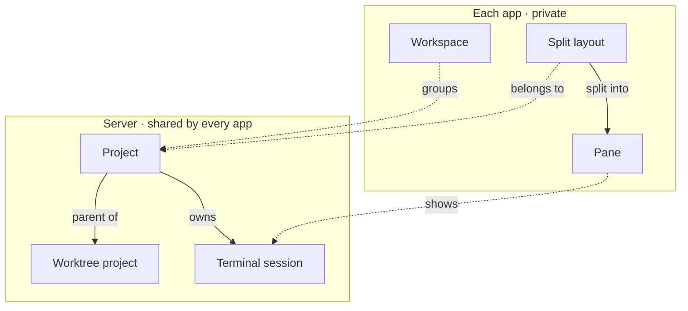
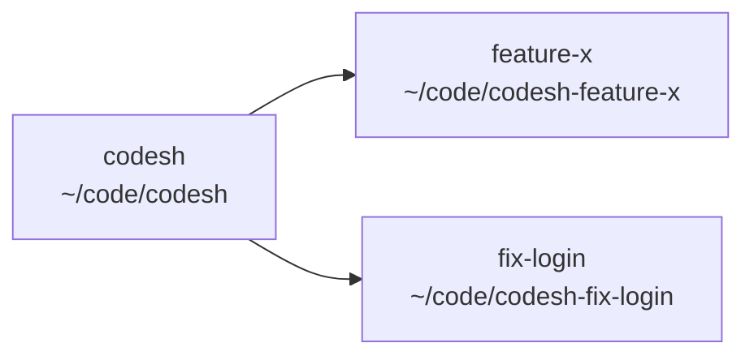

# Product model

The things Codesh is made of, and who owns them.

## The pieces

| Piece | What it is |
| --- | --- |
| Server | Runs on a computer. Owns projects, terminal sessions, and server settings. |
| Project | A folder on a server, with a name. |
| Home | The built-in project for your home folder. |
| Worktree project | A Git worktree, shown under the project it came from. |
| Workspace | A group of projects in one app, used to filter the sidebar. |
| Split layout | A project's panes in the desktop app: zero or one per project. The terminal UI allows several tabs per project. |
| Pane | One view in the layout: a terminal, browser, editor, diff, or the Remote Servers view. |
| Session | A running terminal. Belongs to exactly one project. |
| Paired device | A phone client allowed to connect to the server. |

**Shared or private.** Project names and deletions reach every
app. Layouts, workspaces, and project order stay in the app that made them.

## Projects

- A project is an identity that points to a folder. Two projects can point to
  the same folder. They share its files but are otherwise separate.
- A new project is named after its folder, and can be renamed. The desktop
  app shows an icon it finds among the project's files.
- If the folder disappears, the project shows as failed and can only be
  deleted. An offline server does not make its projects fail.
- Changing directory inside a terminal never moves it to another project.

## Home

Every server has one Home project for the user's home folder. One-off terminals
live there as independent tabs, each with its own split layout. The desktop
sidebar shows these terminals above projects without a Home header, including
terminals from remote Homes. New standalone terminals open in local Home. Home
can't be deleted, have worktrees, or join a workspace, and remains when empty.

## Workspaces

A workspace is a named filter for the sidebar. A project can be in no
workspace, one, or several, and a workspace can be empty. Deleting a workspace
never touches its projects. **Remote Servers** is a fixed workspace, offered
once a remote server has connected, that lists each remote server's Home.

## Worktrees

A worktree project is a child of a normal project, pointing to a Git worktree's
folder. You can create one from a branch or add a worktree that already exists.
It takes the branch name and its parent's color, and has its own panes.
Worktrees can't have children of their own.

Worktrees made outside Codesh show up automatically. A new project shows
worktrees only if its repository already has some; turn them on or off from
the project menu.

After a worktree is deleted outside Codesh, its entry is removed automatically
if it has no panes in this app and no terminal history.

## Deleting

Deleting always asks first and explains what will end.

| You delete | What happens |
| --- | --- |
| A project | It disappears from every app and its terminals end. Files stay on disk. |
| A worktree project | The same, and its worktree folder is removed too. |
| A project with worktrees | Its worktree projects are deleted too. Their folders stay on disk. |
| Home | Not allowed. |

## Panes

- In the desktop app, a project has one split layout, or none when every pane
  is closed. See [Single tab per project](../codesh/single-tab.md).
- The layout splits into panes, side by side or stacked, as deep as you like.
  New panes open to the right of the focused one and splits stay equal-sized.
- Each pane is a card with a header for its title and actions.
- The terminal UI keeps its own tabs and splits per project.
- A terminal's title is the one its program sets, otherwise the running
  program's name, otherwise its folder.
- New terminals open in the project's folder, or optionally in the folder of
  the pane they were split from.
- Terminals support selection, copy and paste, search, links, the mouse, input
  methods, and shell integration: jump between prompts and select a command's
  output.
